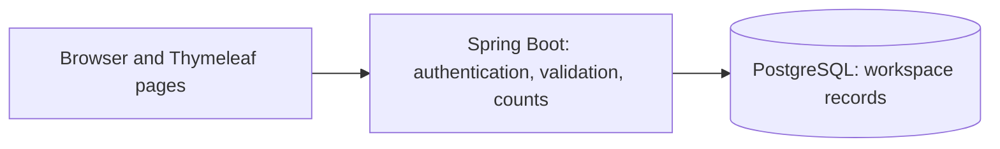

<div align="center">

# CountCheck

**Know your stock. See the difference. Keep the record.**

Inventory count reconciliation with private business workspaces, safe retries, and a timestamped history.

[Open CountCheck](https://countcheck.embarko.app/) · [Run locally](#run-locally) · [Explore the code](code/src/main/java/com/countcheck) · [Report a bug](https://github.com/VJ-veshwikjain2215/CountCheck/issues/new?template=bug_report.yml)

[](https://github.com/VJ-veshwikjain2215/CountCheck/actions/workflows/ci.yml)
[](code/pom.xml)
[](code/pom.xml)
[](code/src/main/resources/db/migration)

</div>

[](https://countcheck.embarko.app/)

## What CountCheck does

Inventory records and physical stock can disagree. CountCheck gives that difference a clear, reviewable record: choose a product, enter the recorded and physical quantities, and save an observation.

- **Private business workspaces** — account-scoped products and history, with cross-workspace access checked on the server.
- **A searchable catalog** — products with SKU, unit, location, and reference quantity; bounded pages and stable cursors.
- **A focused counting flow** — signed difference calculated as physical minus recorded, with an optional note.
- **Safe retries** — a request ID prevents identical double submissions from creating duplicate observations; changed payloads under an existing key are rejected.
- **History you can review** — newest-first records, a differences-only filter, immutable detail pages, and CSV export up to 10,000 records.
- **Account controls** — password changes, one-time recovery codes, session revocation, and password-confirmed workspace deletion.

Counts are manual observations. They do not verify physical stock or automatically adjust inventory. The first release supports one owner per workspace.

## Built with

| Layer       | Technology                                         |
| ----------- | -------------------------------------------------- |
| Application | Java 21, Spring Boot 4.1, Spring MVC               |
| Interface   | Thymeleaf, native CSS and JavaScript               |
| Security    | Spring Security, CSRF, BCrypt, same-origin CSP     |
| Data        | PostgreSQL, JDBC, Flyway migrations                |
| Build       | Maven wrapper, Java and database integration tests |
| Hosting     | Embarko application, Neon PostgreSQL               |
| Automation  | GitHub Actions, Dependabot                         |



Database credentials stay on the server. The browser does not connect directly to PostgreSQL.

## Run locally

### Windows workstation

Install Java 21+ and PostgreSQL command-line tools, then:

```powershell
git clone https://github.com/VJ-veshwikjain2215/CountCheck.git
cd CountCheck/code
./start-local.ps1
```

Open `http://localhost:8080`. The script starts a loopback-only, disposable development database on port 55432. Its local trust authentication is for development only. Do not run Maven `clean` while relying on the database under `code/target/local-postgres`.

### Other environments

Use your own disposable PostgreSQL instance or the [Docker Compose database](code/compose.yaml). Set `DB_JDBC_URL`, `DB_USERNAME`, and `DB_PASSWORD` in the process environment before running `./mvnw spring-boot:run` from `code/`. Windows users can use `./mvnw.cmd`.

See [application setup and configuration](code/README.md) for environment variables, migrations, Docker, and deployment details. `.env.example` contains placeholders; Spring Boot reads process environment variables, not that file automatically.

| Command from `code/`                               | Purpose                                                        |
| -------------------------------------------------- | -------------------------------------------------------------- |
| `./mvnw test`                                      | Unit checks; database tests also run when `DB_JDBC_URL` is set |
| `./mvnw verify`                                    | Build and run verification                                     |
| `./mvnw package`                                   | Build the executable JAR                                       |
| `node --check src/main/resources/static/js/app.js` | Check browser-script syntax                                    |

Use a **disposable database** for integration tests: they create and delete synthetic workspaces. Never point these tests at a customer database.

## Engineering and verification

The current source passed **22 Java tests** in GitHub Actions on Java 21/PostgreSQL, **52 HTTP checks** against an isolated hosted validation branch, and **33 live HTTP checks**. These are recorded checks, not a claim of complete browser accessibility or production-load coverage.

- Per-request member lookup and dashboard aggregates avoid redundant database reads.
- Catalog reads are bounded; CSV output is written in batches of at most 500 rows.
- Static assets have content-versioned URLs and long-lived caching; private HTML remains `no-store`.
- The validation CSS response measured **4,006 gzip bytes versus 17,359 uncompressed bytes**, about 77% smaller. This is a transfer-size observation, not a general page-speed benchmark.

Read [optimization evidence](documents/optimization.md), [live verification](documents/live-verification.md), and the [release checklist](documents/release-checklist.md).

## Repository map

```text
.github/             CI, issue/PR forms, dependency updates, brand banner
code/
  src/main/java/     Application, authorization, persistence and web flows
  src/main/resources/ Templates, static assets, configuration and migrations
  src/test/java/     Unit, database, concurrency and export checks
  ops/               Controlled database, deployment and verification helpers
documents/           Requirements, implementation decisions and release evidence
```

The original demo brief under `documents/project-plan/` is historical context. Current implementation and release documents supersede conflicting assumptions.

## Deployment and limits

The live website runs on Embarko with Neon PostgreSQL in Singapore and a restricted application database login. Credentials, local data, installed dependencies, build outputs and the owner's deployment identity are excluded from Git.

When deploying a fork, configure your own hosting, database, credentials and deployment identity. Keep migrations separate from the restricted runtime login. See [launch notes](documents/embarko-launch.md).

Browser visual/accessibility QA, independent scheduled backups, monitoring and support procedures remain operational follow-up. The privacy page describes current retention and recovery limits. This repository does not promise uninterrupted service or automatic stock correction.

## Contribute or report a problem

Use a [bug report](https://github.com/VJ-veshwikjain2215/CountCheck/issues/new?template=bug_report.yml) for a reproducible issue, or an [improvement request](https://github.com/VJ-veshwikjain2215/CountCheck/issues/new?template=feature_request.yml) for a focused idea. Read [contribution guidance](CONTRIBUTING.md) before opening a pull request.

For vulnerabilities, use [private reporting](https://github.com/VJ-veshwikjain2215/CountCheck/security/advisories/new) and read [SECURITY.md](SECURITY.md). Never put real inventory, personal information, passwords or recovery codes in an issue.

Created by [Veshwik Jain](https://github.com/VJ-veshwikjain2215) · [LinkedIn](https://www.linkedin.com/in/veshwik-jain/) · [Live website](https://countcheck.embarko.app/)
